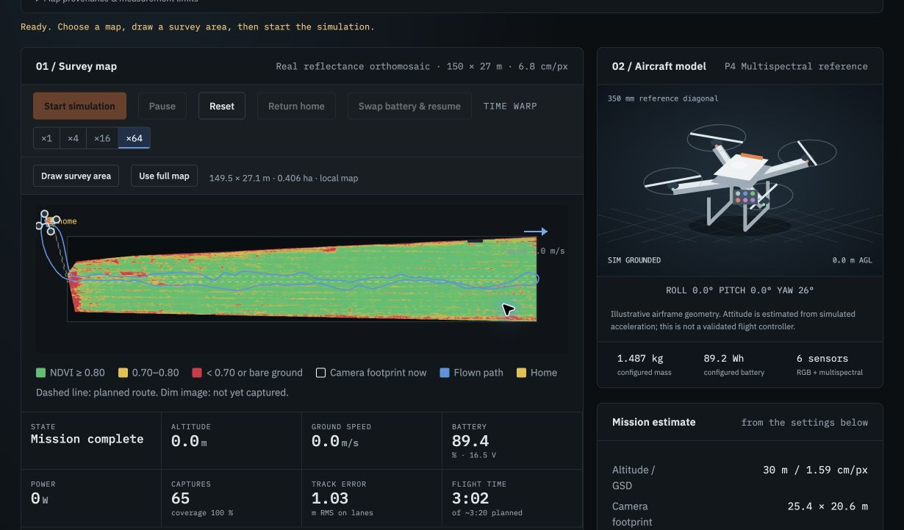
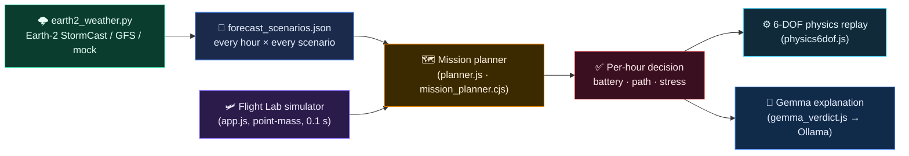

<div align="center">

# 🛰️ TerraDrone Sim

### Know before you fly: a weather-aware survey-drone flight lab, mission planner and 6-DOF physics simulator

<p>
  
  
  
  
</p>
<p>
  
  
  
  
  
</p>



</div>

---

## 🎯 The question it answers

> **"If I launch at this time in 2–3 days, will the drone finish the survey safely, and how much battery will it take?"**

Farm and research crews plan drone surveys days ahead, but wind, gusts, rain, dust and cold decide whether a flight is
safe and whether one battery is enough. TerraDrone Sim turns an **AI weather forecast** for *your* field into a
**per-hour go / no-go decision**, by actually flying the survey in the simulator under every forecast scenario.
A local **Gemma** model (run through **Ollama**) then explains each decision in plain English for the person
deciding whether to fly.

<div align="center">

| 🟢 **CLEARED** | 🟠 **CONDITIONAL** | 🔴 **NOT CLEARED** |
|:---:|:---:|:---:|
| Fly it. | Fly with care: low reserve, long time at full speed, steep tilt, dust or cold. | Don't: gusts over 10 m/s, rain, visibility under 3 miles, temperature out of range, emergency landing, or not enough batteries. |

</div>

---

## 🧭 How it works



1. **Forecast.** `earth2_weather.py` pulls weather for your field's lat/lon (an ensemble from NVIDIA Earth-2
   **StormCast-CONUS**, or NOAA GFS, or synthetic data) and writes `forecast_scenarios.json`.
2. **Plan.** For every launch hour and every scenario, the planner flies your survey with Flight Lab's own simulator,
   using your aircraft settings.
3. **Decide.** Each hour gets CLEARED / CONDITIONAL / NOT CLEARED with the reasons, battery needed, flight time
   and drone stress.
4. **Explain.** The planner's verdict, reasons and numbers (wind, gusts, battery, visibility, recommended launch hour)
   are sent to **Gemma** running locally in Ollama, which writes a short **GO / CAUTION / NO-GO** explanation under the verdict panel.
5. **Check the physics.** Replay the chosen hour in a **6-DOF rigid-body** model to see roll, pitch, tracking error and motor load.

---

## ✨ Features

| | |
|---|---|
| 🗺️ **Flight Lab** | Real field imagery (potato trial, cherry orchard), draw a survey area, live flight simulator with time warp ×16 / ×64 |
| 🌦️ **Weather-aware planner** | Launch-time slider over the whole forecast window; Median / Worst / scenario #n; recommended best hour |
| 💬 **Gemma flight verdict** | A local Gemma model (via Ollama) turns the planner's decision into a plain-English GO / CAUTION / NO-GO explanation for each launch hour. The rules decide; Gemma only explains. Falls back to the planner's own reasons if Ollama is not running |
| 🌫️ **Dust and visibility** | Visibility from blowing dust and rain against the FAA 3-mile minimum |
| 🔋 **Battery planning** | Battery needed per launch hour (median and range) against calm weather; how many packs to carry |
| ⚙️ **6-DOF physics** | 17-state rigid body, RK4 at 500 Hz, Dryden turbulence, geometric SO(3) attitude control, momentum-theory power |
| 📈 **Interactive charts** | Path deviation, tilt and power over time; scrub the timeline and watch a 3D aircraft lean with the wind |
| 🧪 **Tested** | Physics checked against hand calculations (hover thrust, hover power, steady-wind tilt, density scaling) |
| 🏷️ **Honest labels** | Every input is tagged **MODEL**, **DERIVED**, **SPEC** or **ASSUMED**, so you know what to trust |

### Path colors on the map

| Color | Meaning |
|:---:|---|
| 🟢 **Green** | Original path with no wind |
| 🟠 **Orange** | Recommended path for the day (best launch hour, median scenario) |
| 🔵 **Blue** | The selected launch window (and the live simulator path) |
| 🔴 **Red dot** | Emergency landing |

---

## 🚀 Quick start (5 minutes)

**Needs:** Python 3 and a browser. Node.js only for the command-line tools and tests.

```bash
git clone https://github.com/Nikhitha-byte/TERRADRONE-SIM.git
cd TERRADRONE-SIM
python -m http.server 8000
```

Open **http://127.0.0.1:8000/index.html**. (Double-clicking `index.html` also works; then click **Load forecast** and pick `forecast_scenarios.json`.)

1. **Choose the field.** Pick a map at the top. To survey only part of it, click **Draw survey area** and drag a rectangle.
2. **Plan the launch window** (panel *04 / Mission planner*). The sample forecast loads by itself. Set how many batteries you carry and click **Plan launch window**.
3. **Read the decision.** Drag the launch-time slider (or use ← →). Each hour shows the verdict and the reasons.
4. **Watch it fly.** **Fly this in the simulator** replays that scenario live (use Time warp).
5. **Run the physics** (panel *05 / Physics (6-DOF)*). **Run 6-DOF physics** flies the survey three times (no wind, recommended path, selected window)
   and compares flight time, energy, tilt, tracking error, distance from the original path and motor load.
   **Download CSV** exports the run.

### Optional: turn on the Gemma verdict

The app works without this. Without Ollama, the box under the verdict panel shows the planner's own reasons instead.

1. Install [Ollama](https://ollama.com) and make sure it is running (check with `ollama --version`).
2. Download the model (about 3 GB):
   ```bash
   ollama pull gemma3:4b
   ```
3. Serve the page over HTTP (`python -m http.server 8000`, as above) and open it at `http://127.0.0.1:8000/index.html`.
   Opening `index.html` by double-click cannot reach Ollama.
4. Click **Plan launch window**, then click different launch hours. The Gemma verdict appears under the big verdict panel.

If the box says "Gemma offline" and the browser console shows a CORS error, allow the page to call Ollama and restart Ollama:

```bash
# Windows (PowerShell)
setx OLLAMA_ORIGINS "*"
```

Gemma runs on your own machine, so teammates need Ollama and the model installed on theirs to see it.
The model name and URL are set at the top of `gemma_verdict.js` (`GEMMA_MODEL`, `OLLAMA_URL`).

**Checks:**

```bash
node tests/flight.test.cjs     # Flight Lab simulator
node tests/physics.test.cjs    # 6-DOF physics vs hand calculations
```

---

## 🌩️ 1 · Forecast the weather

| Source | What it is | Needs |
|---|---|---|
| `--source stormcast` | NVIDIA Earth-2 **StormCast-CONUS**: AI ensemble at 3 km, hourly, steered by NOAA GFS for days-ahead plans | NVIDIA GPU, `pip install "earth2studio[data,stormcast-conus]"`, US fields only |
| `--source gfs` | NOAA GFS forecast (not AI), 0.25°, one scenario, includes surface gusts | Internet, no GPU, works worldwide |
| `--source mock` | Synthetic weather with a gust front and showers | Nothing (demo and testing) |

```bash
python earth2_weather.py --source stormcast --lat 29.6436 --lon -82.3549 --field-name "UF survey field" \
       --mission-time "2026-10-27 09:00" --window 8 --members 2 --alt 30
```

* `--mission-time` is local time (`--tz`, default America/New_York); `--window` is the number of launch hours to check.
* `--map-heading` is the compass bearing the top of your map points to (0 = north).
* StormCast downloads about 4 GB of weights and needs HRRR and GFS data, and it needs a large GPU. **Run it before the demo and keep the output.**

## 🛩️ 2 · Fly the mission in every scenario (command line)

```bash
node mission_planner.cjs --forecast forecast_scenarios.json --map field --batteries 2
node mission_planner.cjs --forecast forecast_scenarios.json --map rect --size 400x300 --batteries 8
```

* `--map field` (potato trial), `cherry` (orchard), or `rect --size WxH` for any field size in metres.
* `--area x,y,W,H` limits the survey to part of the map; `--base-config` uses your saved aircraft settings.
* Uses **`app.js` unchanged**, headless: same `step()`, same 0.1 s timestep, same controller, power and return-to-home logic.
* Writes `mission_plan.html`, plus `replay_*.json` files you can load in Flight Lab to watch a scenario fly.

---

## 💬 3 · Gemma explanation (Ollama)

`gemma_verdict.js` is called from the mission planner every time you pick a launch hour, scenario or finish planning.

* **Input:** the planner's status for that hour (CLEARED / CONDITIONAL / NOT CLEARED), its reasons, launch time, battery needed,
  flight time, wind at altitude, gust spread, temperature, rain and the recommended launch hour.
* **Prompt:** Gemma is told the decision is already made, to explain it in two short sentences using only that data, and not to change the decision or invent numbers.
* **Output:** the label (**GO**, **CAUTION** or **NO-GO**) is set by the app from the planner's status, followed by Gemma's text.
* **Safety:** the go / no-go decision always comes from the simulator's rules. Gemma cannot change it. Temperature is 0.2 to keep wording steady.
* **Offline behaviour:** if Ollama is not running, the same box shows the planner's reasons and the note "Gemma offline".
* **Responsiveness:** requests wait 500 ms and stale answers are dropped, so dragging the launch-time slider does not flood Ollama.

### Next step: photo analysis with Gemma

After a simulated flight, the survey photos could be analysed by a vision-capable Gemma model to flag weeds, abiotic stress
(drought, heat, nutrient) and disease, using a prompt-based approach on sample images. This is **not built yet**.
Any photos shown would come from the UF / IFAS research datasets, **not from our own flights**, because this project is simulation only.
Higher accuracy would need fine-tuning on the datasets' labelled masks.

---

## 🔬 Under the hood

### The 6-DOF physics model

State: position, velocity, attitude quaternion, body rates and the 4 motor thrusts (17 states), integrated with
4th-order Runge–Kutta at 500 Hz (250 Hz for long surveys).

* `p′ = v` · `v′ = (R(q)·[0,0,ΣTᵢ] + F_drag(v − wind))/m − g` · `q′ = ½ q⊗[0,ω]` · `ω′ = J⁻¹(τ − ω×Jω)` · `Tᵢ′ = (Tᵢ,cmd − Tᵢ)/τ_motor`
* **Wind:** forecast mean wind + Dryden low-altitude turbulence (MIL-HDBK-1797) + GNSS noise.
* **Control:** route guidance → velocity PI (learns the wind) → thrust vector (35° tilt limit) → geometric attitude control on SO(3) → X-quad mixer with motor limits.
* **Power:** momentum theory per rotor (`Pᵢ ∝ Tᵢ^1.5/√(2ρA)`), calibrated to Flight Lab's hover power, so thin, hot or humid air costs more.
* **Airframe:** mass, size and props follow the DJI P4 Multispectral; inertia, drag, motor lag and thrust-to-weight are assumptions, tagged in the panel.

### Wind coupling in Flight Lab

The flight controller is not told the wind. Like a real autopilot it estimates it from the gap between ground and air
velocity (3 s time constant), so gusts, takeoff and turns push the drone off its path, while steady wind mainly costs
airspeed, power and tilt. The 3D aircraft leans by the angle that balances acceleration and air drag
(14.4° in an 8 m/s crosswind, against 13.9° from the 6-DOF model).

### What feeds the simulator, and how honest each piece is

| Effect | How | Label |
|---|---|:---:|
| Wind, direction | Forecast 10 m wind scaled to flight altitude (`U·(alt/10)^0.14`) | MODEL + ASSUMED profile |
| Gusts | √((0.15·U)² + ensemble spread²); GFS adds its gust field | ASSUMED turbulence + MODEL |
| Air density → hover power | `phov × √(1.225/ρ)` from forecast temperature, pressure, humidity | DERIVED |
| Cold battery | −0.75 %/°C below 20 °C, floor 80 % | ASSUMED |
| Rain | Radar reflectivity → mm/h. Rain > 0.5 mm/h = NOT CLEARED (no published rain rating). Not in flight physics | DERIVED |
| Dust → visibility | Dust + rain light extinction → visibility. < 4.8 km (FAA 3 miles) = NOT CLEARED, < 8 km = CONDITIONAL | ASSUMED |
| Limits | 10 m/s wind, 0–40 °C; visibility ≥ 3 statute miles | SPEC (DJI P4 Multispectral); FAA 14 CFR 107.51(c) |

**Status per scenario.** NOT CLEARED for gusts over 10 m/s, rain, visibility under 3 miles, temperature out of range,
an emergency landing, or needing more batteries than you carry. CONDITIONAL for using every battery, landing near the
reserve, more than 5 % of survey time at full airspeed, more than 30° tilt, more than 2 m tracking error, low coverage, dust or cold.

**Status per hour.** NOT CLEARED if half or more scenarios are; CONDITIONAL if any is NOT CLEARED or half are CONDITIONAL; otherwise CLEARED.

### Dust and visibility

FAA 14 CFR 107.51(c) requires at least **3 statute miles (4.8 km)** of flight visibility from the control station.
The forecast step estimates visibility from blowing dust (wind, humidity, rain) and rain, which both scatter light and add up.
Dust is not a force in the flight physics: at these concentrations it changes whether you may fly and how good the images are,
not how the drone flies. The visibility numbers are an estimate (ASSUMED empirical relation), not a model output.

### Known limits

* The planner sweeps with Flight Lab's fast point-mass simulator; the 6-DOF physics runs on the selected hour and scenario.
* One forecast grid cell is used for the whole field.
* The simulator's return-home check assumes calm air, which is why strong headwinds can end in an emergency landing.
* Gemma's text is an explanation, not a safety system. Small local models can word things imperfectly, so always read the planner's reasons and confirm real conditions.
* The Gemma verdict needs Ollama running on the same computer as the browser.

---

## 📁 Files

| File | What it is |
|---|---|
| `index.html`, `app.js` | Flight Lab: map, survey planning, the flight simulator (`step()`), live view |
| `planner.js` | 04 / Mission planner panel inside Flight Lab (also calls the Gemma verdict) |
| `gemma_verdict.js` | Sends the planner's decision to Gemma through Ollama and shows the GO / CAUTION / NO-GO explanation |
| `physics6dof.js`, `physics_view.js` | 6-DOF rigid-body physics engine and the 05 / Physics panel |
| `drone_data.js`, `drone_data5.js` | Map imagery: potato trial (FIELDimageR) and cherry orchard (Kerasia) |
| `earth2_weather.py` | Weather forecast for your field → `forecast_scenarios.json` (Earth-2 StormCast, GFS, or mock) |
| `forecast_scenarios.json` | Sample forecast so the planner works out of the box |
| `mission_planner.cjs`, `mission_report.cjs` | Same planning from the command line → `mission_plan.html` report |
| `tests/flight.test.cjs`, `tests/physics.test.cjs` | Simulator and physics tests |
| `Drone_Scout_Guide.pdf` | Full guide: drone, battery, limits and the weather-to-mission coupling |

---

<div align="center">

**TerraDrone Sim**: simulation only, no hardware. Weather is a forecast and several inputs are labeled ASSUMED, so confirm real conditions before any real flight.

</div>
